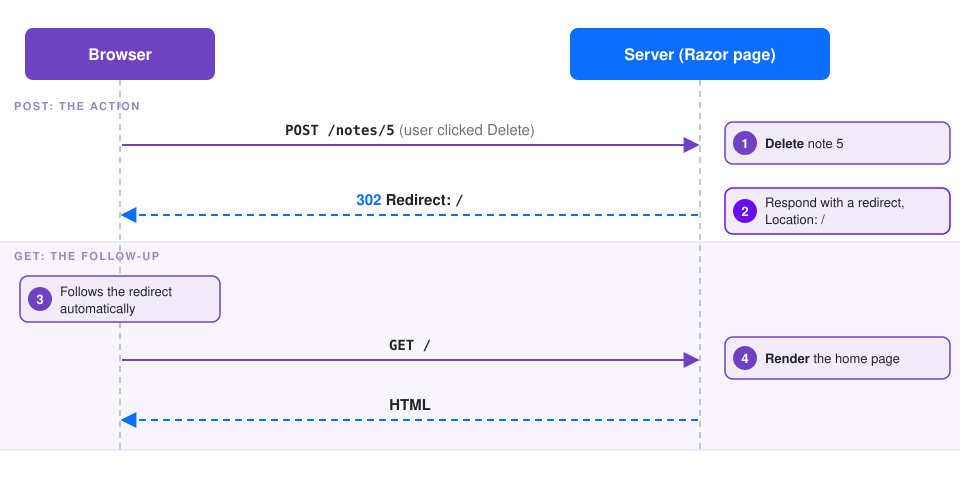

# Lesson 8: Deleting with Small Forms and `confirmActions.js`

The last feature is deleting notes and categories. You'll add a small **Delete** button to the note page and the category page. Each button is a tiny HTML form that **POSTs** back to the page. A ready-made script, **`confirmActions.js`**, asks *"Are you sure?"* before the form is sent.

## 8.1 Why a form, and why POST?

You could make Delete a plain link such as `<a href="notes/5/delete">`, but **GET requests must never change data.** Browsers prefetch links, link previews follow them, and search-engine crawlers click everything. Changing data takes a **POST**, and in plain HTML that means a `<form method="post">`.

After the server handles the POST, it **redirects** the browser to another page:



Why redirect instead of returning HTML straight from the POST? If the user refreshes a page that came from a POST, the browser **re-submits the form**. After a redirect, a refresh is just a harmless GET. This pattern is called **Post/Redirect/Get**.

## 8.2 Install `confirmActions.js`

1. Create a `wwwroot/js` folder and copy [`starter/confirmActions.js`](starter/confirmActions.js) into it.
2. In **`Components/App.razor`**, load it **just above** the existing `blazor.web.js` script:

   ```razor
       <script src="@Assets["js/confirmActions.js"]"></script>
       <script src="@Assets["_framework/blazor.web.js"]"></script>
   ```

That's all. From now on, any `<form>` or `<a>` with a `data-confirm` attribute shows a confirmation dialog first:

```html
<form method="post" data-confirm="Delete this note?"> ... </form>
```

If the user clicks **Cancel**, nothing is sent. The script is about 30 lines of commented JavaScript; open it to see how it works. (Hint: look up *event delegation* and the *capture phase*.)

> **Stuck? No dialog appears and the item is deleted right away.** The script isn't loaded. Check the path (`wwwroot/js/confirmActions.js`) and the `<script>` line in `App.razor`, then do a hard refresh (**Ctrl+Shift+R**). In dev tools → **Console**, a 404 for `confirmActions.js` means the file is in the wrong place.

## 8.3 Delete a note

In **`Components/Pages/Notes/NoteDetail.razor`**, add this form right after the **Edit** link from Lesson 7:

```razor
        @* data-confirm is handled by confirmActions.js (Lesson 8) *@
        <form method="post" @onsubmit="DeleteAsync" @formname="delete-note" class="d-inline"
              data-confirm="Delete this note? This can't be undone.">
            <AntiforgeryToken />
            <button type="submit" class="btn btn-outline-danger">Delete</button>
        </form>
```

And add this method to its `@code` block, after `OnInitializedAsync`:

```csharp
    private async Task DeleteAsync()
    {
        await Notes.DeleteNoteAsync(Id);
        Navigation.NavigateTo("");
    }
```

Piece by piece:

| Piece | What it does |
|---|---|
| `method="post"` | The browser sends a POST to the current URL (`/notes/5`) |
| `@onsubmit="DeleteAsync"` | When this form is POSTed, Blazor calls `DeleteAsync`. In a static page, `@onsubmit` is the one event that works without interactivity, because it rides on a real HTTP request. |
| `@formname="delete-note"` | **Required for static SSR forms.** A page could have several forms, and the name tells Blazor which one was posted. |
| `<AntiforgeryToken />` | Adds a hidden security token. `app.UseAntiforgery()` in `Program.cs` rejects POSTs without one, which stops other websites from tricking a user's browser into submitting your forms (*cross-site request forgery*). |
| `data-confirm="..."` | Read by `confirmActions.js`, not by Blazor |
| `Navigation.NavigateTo("")` | During a static SSR POST, this sends the browser a **302 redirect** to the home page |

**The page runs twice.** The POST creates a brand-new `NoteDetail` component, just like a GET would. `OnInitializedAsync` loads the note again, *then* Blazor calls `DeleteAsync`. Nothing survives between the GET that showed the page and the POST that deletes the note, except what's in the URL and the form.

> **Stuck? `The POST request does not specify which form is being submitted`.** Add `@formname="..."` to the `<form>`.

> **Stuck? `A valid antiforgery token was not provided with the request`.** Add `<AntiforgeryToken />` inside the `<form>`.

## 8.4 Delete a category

In **`Components/Pages/Categories/CategoryNotes.razor`**, replace the `<h1>` with a header that holds a delete form:

```razor
    <div class="d-flex justify-content-between align-items-center mb-4">
        <h1>@category.Name</h1>

        <form method="post" @onsubmit="DeleteAsync" @formname="delete-category"
              data-confirm="Delete this category? Its notes will be kept.">
            <AntiforgeryToken />
            <button type="submit" class="btn btn-outline-danger btn-sm">Delete category</button>
        </form>
    </div>
```

And add the handler to its `@code` block:

```csharp
    private async Task DeleteAsync()
    {
        await Notes.DeleteCategoryAsync(Id);
        Navigation.NavigateTo("");
    }
```

`NoteService.DeleteCategoryAsync` deletes only the category. Its notes stay; they just lose that category.

## 8.5 Try it

1. Open a note and click **Delete**. Click **Cancel** in the dialog: nothing happens. Click **Delete** again and confirm: you land on the home page and the note is gone.
2. Delete a category that has notes. The notes are still on the home page, and the category is gone from the sidebar.
3. In the browser dev tools **Network** tab, delete something and look for the `POST` followed by a redirect and a `GET`.
4. After deleting, **refresh** the home page. The browser repeats the harmless `GET /`, not the `POST`.
5. **Experiment:** remove `<AntiforgeryToken />` from `NoteDetail.razor` and try deleting. You'll get a 400 error. Put it back.

## 8.6 Check your understanding

1. Why is Delete a form that POSTs rather than a link? *(GET requests must never change data)*
2. Why redirect after a successful POST? *(Post/Redirect/Get: refreshing won't re-submit the form)*
3. What does `@formname` do? *(It identifies which form on the page was posted)*
4. Which component instance handles the POST: the same one that rendered the page? *(No, a brand-new one. Static SSR components don't survive between requests.)*
5. Who reads the `data-confirm` attribute: Blazor or the browser? *(The browser, through `confirmActions.js`. Blazor never sees the dialog.)*

**Next:** [Lesson 9: Review: questions and answers](09-review.md)
